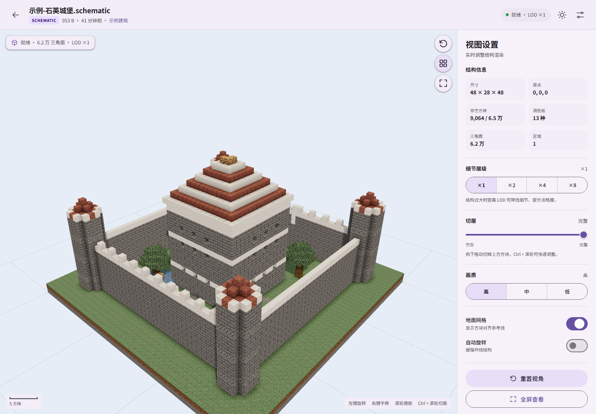
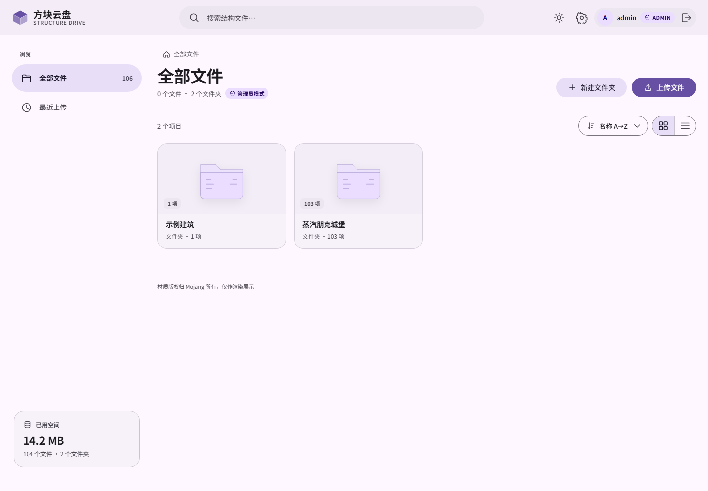
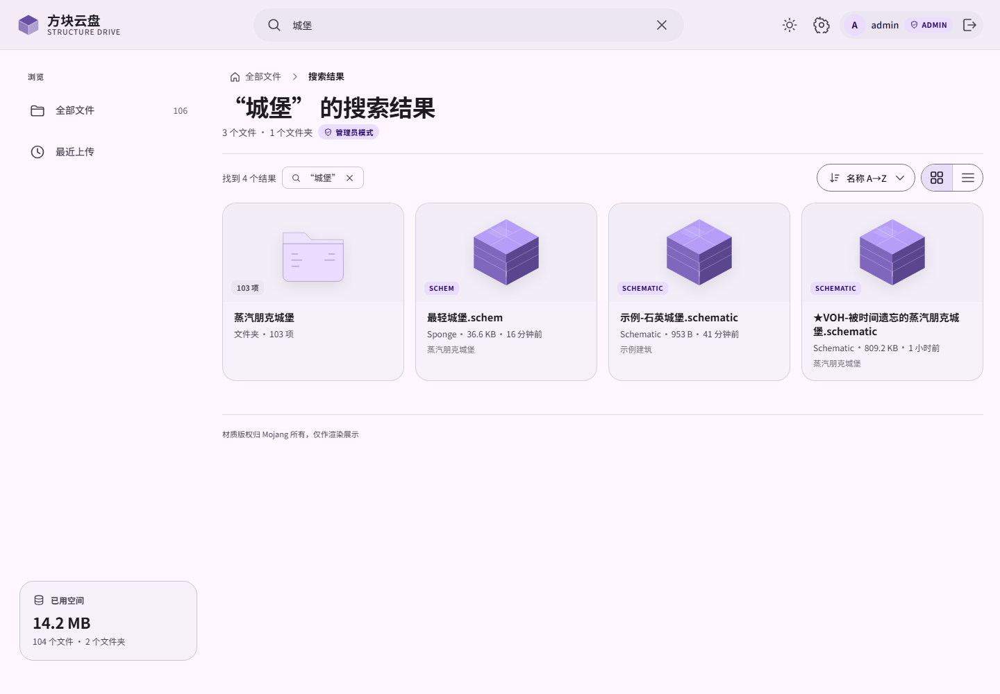
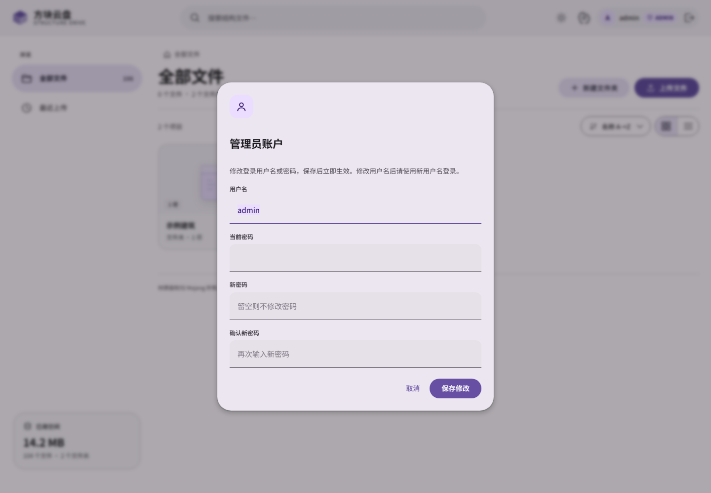

# 方块云盘 · Structure Drive

一个用 **Python Flask** 编写的 Minecraft 结构文件云盘：访客可以浏览、在浏览器里 360° 查看结构；管理员登录后可以上传文件、新建文件夹、重命名和删除。

界面使用 **Material Design 3** 设计语言，图标全部为内联 SVG（没有图标字体、Emoji 或背景装饰符号），支持浅色 / 深色主题和手机布局。



## 功能

- **10 种结构格式的 3D 预览**
  `.mcstructure`、`.litematic`、`.schem`、`.wsmr`、`.bdx`、`.nbt`、`.schematic`、`.mcworld`、`.mcpack`、`.mcaddon`
- **管理员模式**
  登录后可多文件上传、新建文件夹、重命名、删除；访客只读浏览和预览。
- **网页内账户管理**
  管理员可在右上角“账户设置”中修改用户名和密码，无需改代码或环境变量。
- **大文件分批上传**
  前端按大小自动拆分上传请求，避免几十个文件一次上传时被网络波动或超时中断。
- **云盘式文件库**
  文件夹层级、面包屑、全局搜索、按名称 / 时间 / 大小排序、网格 / 列表视图。
- **3D 查看器**
  真实方块材质图集、环境光照与阴影、LOD ×1/×2/×4/×8、切层、画质切换、全屏、地面网格、自动旋转、缩放比例尺、结构信息面板。
- **自动 LOD**
  服务端读取 `.schematic` / `.schem` 的 `Width/Height/Length`，按结构体积选择初始 LOD；大型结构默认不会以最高细节硬加载。
- **渲染性能优化**
  解析核心只生成外露面，前端再做背面剔除；静止时不再每帧重绘，只有旋转/缩放/切层/自动旋转时才渲染。移动端默认中画质，关闭阴影和抗锯齿。
- **完全本地化**
  Three.js、WASM 解析核心、材质图集、`bake.bin` 全部随项目提供，不使用 CDN；装好依赖后可离线运行。
- **安全基础**
  Session 登录、CSRF 校验、上传扩展名白名单、UUID 落盘、原始文件名清洗、只允许白名单排序字段。

| 管理员文件库 | 全局搜索 | 手机布局 |
| --- | --- | --- |
|  |  |  |

## 快速开始

要求 **Python 3.10+**，推荐 3.11 / 3.12 / 3.13 / 3.14。

```powershell
cd mccloud
python -m venv .venv
.venv\Scripts\Activate.ps1
python -m pip install -r requirements.txt
python app.py
```

打开 <http://127.0.0.1:5000>。

Windows 也可以直接双击 `start.bat`（会检查 Flask 并启动）。

## 一键部署到服务器（Docker）

Windows 双击 `deploy.bat`，按提示输入服务器 root 密码即可。脚本会：

1. 打包代码，并对 SQLite 和已上传文件做一致性快照；
2. 通过 SFTP 上传到服务器；
3. 在服务器的 `/opt/mccloud` 构建 Docker 镜像；
4. 停止旧容器，启动 `mccloud` 容器并只监听本机 **25561**（由 Nginx 反向代理）；
5. 等待 `/health` 通过，并通过 HTTPS 做一次公网健康检查。

当前脚本默认目标：`root@mcbe.l.cd`，应用地址 <https://mcbe.l.cd:25560>。需要修改时编辑 `deploy.bat` 顶部的 `DEPLOY_HOST` / `DEPLOY_USER` / `DEPLOY_PORT`。

```powershell
# 也可以手动运行
python tools\deploy_server.py

# 强制用本地 data 覆盖服务器 data（会覆盖服务器上的上传文件，危险）
python tools\deploy_server.py --reset-data
```

- **首次部署**会自动把本地 `data/`（包含已上传结构）带到服务器。
- **后续更新**默认保留服务器上的 `data/`，不会覆盖用户新上传的文件。
- 服务器需要已安装 Docker，并放行 25560 端口。
- 部署日志在服务器 `/tmp/mccloud-deploy.log`，容器日志用 `docker logs mccloud` 查看。

### HTTPS / SSL

当前使用已有的 Nginx 通配符证书终止 TLS：

- 公网：`https://mcbe.l.cd:25560`（HTTP 会自动 301 到 HTTPS）
- Docker 容器只绑定 `127.0.0.1:25561`，不直接暴露公网
- Nginx 配置参考：[deploy/nginx-mccloud-ssl.conf](deploy/nginx-mccloud-ssl.conf)
- 证书路径：`/etc/nginx/ssl/mcbe.l.cd-fullchain.pem`、`/etc/nginx/ssl/mcbe.l.cd-privkey.pem`
- 上传超时和 `proxy_request_buffering off` 已在 Nginx 中配置，适合大文件上传

如果服务器重装或迁移，需要把上面的 Nginx 配置放到 `/etc/nginx/conf.d/mccloud-ssl.conf`，执行 `nginx -t && nginx -s reload`，并让 Docker 只映射到 `127.0.0.1:25561:25560`。

### 管理员账号


全新安装的默认账号：`admin`，密码：`admin123`。如果 `data/` 已经存在，则使用数据库里已经设置过的管理员密码（脚本不会重置它）。

登录后点击右上角的账户设置按钮，即可在网页中修改用户名和密码。



也可以提前设置环境变量：

```powershell
$env:MCCLOUD_ADMIN_PASSWORD = "换成你自己的强密码"
python app.py
```

如果数据库里已经存在管理员，且设置了 `MCCLOUD_ADMIN_PASSWORD`，启动时会同步更新密码。

## 环境变量

| 变量 | 默认值 | 说明 |
| --- | --- | --- |
| `MCCLOUD_HOST` | `127.0.0.1` | 监听地址；局域网访问可设为 `0.0.0.0` |
| `MCCLOUD_PORT` | `5000` | 端口 |
| `MCCLOUD_DATA` | `./data` | 数据目录（SQLite、上传文件、密钥） |
| `MCCLOUD_ADMIN_USER` | `admin` | 管理员用户名 |
| `MCCLOUD_ADMIN_PASSWORD` | `admin123` | 管理员密码；设置后会在启动时同步 |
| `MCCLOUD_SECRET_KEY` | 自动生成 | Flask session 密钥；生产环境请固定 |
| `MCCLOUD_MAX_UPLOAD_MB` | `1024` | 单次请求上传上限（MB） |

## 目录结构

```text
mccloud/
├─ app.py                    Flask 应用、登录、文件 API、尺寸探测
├─ requirements.txt
├─ start.bat                 本机启动
├─ deploy.bat                Windows 一键部署
├─ Dockerfile                生产镜像（Gunicorn，25560）
├─ .dockerignore
├─ deploy/nginx-mccloud-ssl.conf  Nginx HTTPS 反向代理参考配置
├─ templates/
│  ├─ base.html              主题、SVG 图标、Snackbar
│  ├─ _icons.html            内联 SVG 图标 sprite
│  ├─ macros.html            logo / 文件立方体 / 文件夹 / 空状态插画
│  ├─ drive.html             文件库
│  ├─ preview.html           3D 预览
│  ├─ login.html
│  └─ error.html
├─ static/
│  ├─ css/app.css            MD3 tokens + 云盘组件
│  ├─ css/viewer.css         3D 查看器与侧边设置面板
│  ├─ js/app.js              主题、菜单、对话框、Snackbar、API
│  ├─ js/drive.js            账户、上传、文件夹、重命名、删除、视图切换
│  ├─ js/viewer.js           Three.js 场景、LOD、切层、相机、交互
│  ├─ js/sv-worker.js        Web Worker：调用 WASM 解析并回传几何
│  ├─ js/core-probe.js       32 位 WASM 核心装载
│  ├─ wasm/core.js
│  ├─ wasm/core.wasm         结构解析 / 网格化 / 烘焙核心
│  ├─ gen/atlas.png          方块材质图集
│  ├─ gen/atlas_t.png        透明方块材质图集
│  ├─ gen/bake.bin
│  ├─ gen/bake_meta.json
│  └─ vendor/three/          Three.js + OrbitControls
├─ data/
│  ├─ mccloud.db             SQLite（用户、文件夹、文件索引）
│  ├─ secret_key
│  ├─ files/                 实际上传的文件（UUID 命名）
│  └─ samples/               示例结构（可选）
├─ docs/                     README 截图
└─ tools/
   ├─ make_sample.py         纯标准库生成一个小型 .schematic 示例
   └─ deploy_server.py       远程部署逻辑（BAT 调用）
```

## 3D 查看器说明

- **多区域文件**：默认只渲染第 1 个区域。
- **看不见的面**：方块与相邻方块之间的内部面在几何生成阶段已经剔除，实际统计到的是外露表面；一万级三角面对建筑来说属于正常范围。
- **移动端**：默认 `中` 画质，像素比 1.25，关闭阴影/抗锯齿；静止画面不重绘。拖动或开启自动旋转才会持续渲染。
- **超大结构**：解析发生在 Web Worker 中，需要占用较多内存和 CPU。默认会根据结构体积选择 LOD；如果浏览器内存不足或设备较旧，建议切换更高 LOD（更省资源）。
- **不同格式**：`.schem` / `.schematic` 会额外读取头部尺寸；其他格式无法在服务端安全读取尺寸时，按文件大小估算初始 LOD。
- **移动端首次加载**：解析核心、材质包等大文件已预压缩（gzip），首次约需下载 1.5 MB；加载完成后浏览器会缓存，后续打开会快很多。

## 部署提示

Flask 自带服务器只适合本地开发。对外部署建议使用 Waitress（Windows）或 Gunicorn（Linux）：

```powershell
pip install waitress
waitress-serve --listen=0.0.0.0:5000 app:app
```

并务必：

1. 修改管理员密码；
2. 固定 `MCCLOUD_SECRET_KEY`；
3. 通过 HTTPS 反向代理访问，并把 `SESSION_COOKIE_SECURE` 设为 `True`；
4. 备份 `data/`（数据库和上传文件都在这里）；
5. 不要直接暴露开发服务器到公网。

## 版权说明

- Minecraft 材质版权归 **Mojang Studios** 所有，本项目仅用于结构渲染展示，与 Mojang / Microsoft 无关联。
- 示例结构由 `tools/make_sample.py` 程序化生成，可自由替换。
